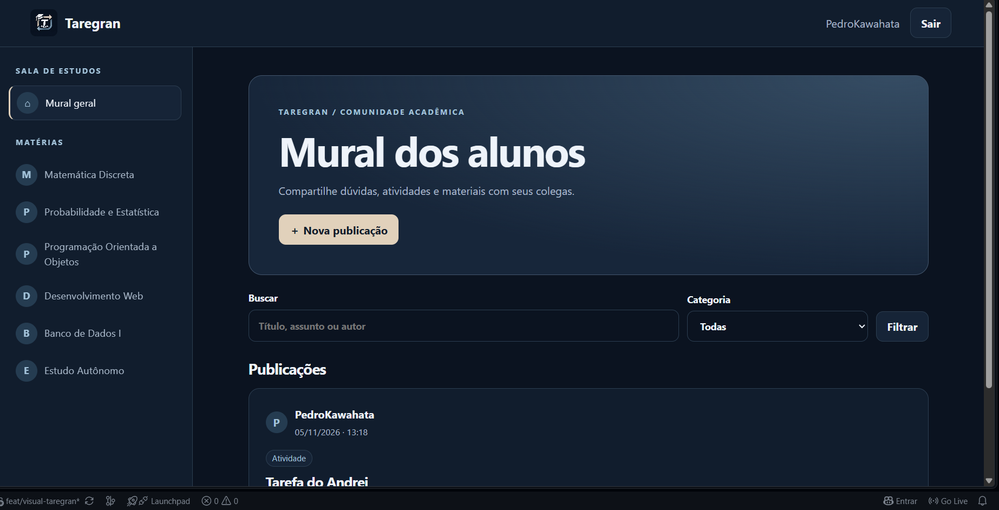
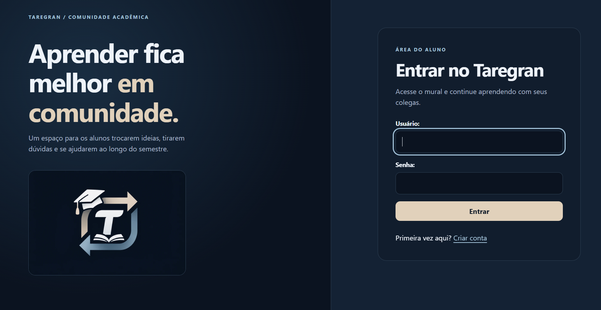

                    # Taregran

O Taregran é uma aplicação acadêmica desenvolvida com Django para aproximar estudantes. Os usuários podem publicar dúvidas, atividades, conteúdos e materiais de estudo, responder às publicações de colegas e marcar uma resposta como solução.
Funcionalidades
- Cadastro, login e logout de alunos.
- Mural com as publicações mais recentes.
- Busca por título, conteúdo ou nome de usuário.
- Filtro por categoria e paginação.
- Criação, edição e exclusão de publicações.
- Respostas vinculadas à publicação e identificadas pelo aluno que as enviou.
- Seleção da melhor resposta pelo autor da publicação.
- Controle de acesso: somente o autor pode editar, excluir ou escolher a melhor resposta da própria publicação.
- Painel administrativo do Django em /admin/.
Tecnologias
- Python 3.13 (versão usada nos testes desta entrega).
- Django 6.1.2.
- tzdata 2026.6, para disponibilidade dos fusos IANA também no Windows.
- SQLite para desenvolvimento.
- Bootstrap 5 e CSS próprio para a interface.
Como executar no Windows

## Telas do Taregran

### Mural de publicações

### Publicação com resposta marcada como solução

Abra o terminal na pasta do projeto e execute:
# 1. Criar o ambiente virtual
py -m venv .venv

# 2. Ativar o ambiente virtual
.venv\Scripts\Activate.ps1

# Se o PowerShell bloquear a ativação, use o Prompt de Comando:
# .venv\Scripts\activate.bat

# 3. Atualizar o instalador e instalar as dependências
python -m pip install --upgrade pip
pip install -r requirements.txt

# 4. Criar as tabelas no banco SQLite
python manage.py migrate

# 5. (Opcional) Criar uma conta de administrador
python manage.py createsuperuser

# 6. Iniciar o servidor local
python manage.py runserver
Abra http://127.0.0.1:8000/ no navegador. O painel administrativo fica em http://127.0.0.1:8000/admin/.
Comandos úteis
python manage.py check
python manage.py makemigrations
python manage.py migrate
python manage.py test
python manage.py runserver
Estrutura principal
Taregran/
├── accounts/                 # Cadastro, login e logout
├── community/                # Publicações, respostas e regras da comunidade
│   ├── migrations/            # Histórico do esquema do banco
│   ├── templates/community/   # Páginas do mural e das publicações
│   └── static/community/      # CSS da comunidade
├── taregran/                 # Configurações e URLs do projeto Django
├── templates/partials/       # Navbar e rodapé compartilhados
├── manage.py
└── requirements.txt
Modelo de dados
- Post: representa uma publicação. Possui título, descrição, categoria, autor, datas e estado de resolução.
- Answer: representa uma resposta. Está ligada a uma publicação e ao aluno que a escreveu. O campo is_solution indica a resposta escolhida pelo autor da publicação.
- User: usa o sistema de autenticação nativo do Django. Assim, não existe uma segunda tabela de alunos com dados duplicados.
Observações de segurança
A chave secreta padrão do arquivo de configurações serve somente para desenvolvimento local. Antes de publicar a aplicação na internet, defina DJANGO_SECRET_KEY, DJANGO_DEBUG=False e DJANGO_ALLOWED_HOSTS por variáveis de ambiente, configure HTTPS e siga o checklist de implantação do Django. O servidor runserver é apenas para desenvolvimento.